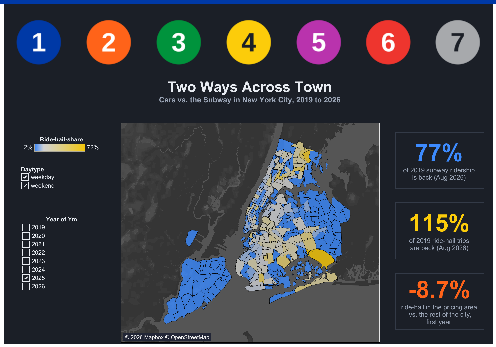

# ride-hail-vs-subway: NYC Urban Mobility Before and After Congestion Pricing
Comparison of ride-hailing and subway transportation.

**Where and when do New Yorkers choose app-based cars over the subway, and what changed after congestion pricing?**

An analysis of New York City's ride-hailing and subway activity from February 2019 through August 2026, examining temporal patterns, geographic differences, and changes following the introduction of congestion pricing.

## Overview

New York City's _congestion pricing program_ introduced a major change to the cost of driving into Manhattan. 
My project examines how app-based ride-hailing activity and subway ridership evolved before and after the policy took effect.

Using trip-level ride-hailing records, hourly subway ridership data, and NYC taxi zone geography, I built a geographic and temporal comparison of two urban transportation modes.

The analysis distinguishes changes observed after congestion pricing from effects that can be confidently attributed to the policy.

## Research Questions

- Where and when does app-based ride-hailing activity concentrate relative to subway ridership?
- How did ride-hailing and subway activity recover relative to 2019 levels?
- Did ride-hailing activity actually change differently inside and outside the congestion pricing area _after_ implementation?
- Did subway ridership exhibit a corresponding change?

## Data Sources

| Dataset | Source | Coverage |
|---|---|---|
| High-volume for-hire vehicle trip records | NYC Taxi & Limousine Commission (TLC) | February 2019–August 2026 |
| Subway hourly ridership | New York State Open Data (MTA) | February 2019–August 2026 |
| Taxi zone boundaries and lookup table | NYC TLC | Geographic reference data |

The ride-hailing data covers Uber, Lyft, Via, and other licensed high-volume for-hire vehicle services. *It excludes yellow and green taxis.*

## Methodology

### 1. Aggregation and geographic alignment

Ride-hailing trips were aggregated by month, hour, company, pickup zone, and drop-off zone.

Subway stations were assigned to the taxi zones in which they are located, allowing subway entries and ride-hailing activity to be compared across a shared geographic framework.

### 2. Ride-hail share proxy

I calculated a ride-hail share proxy as:

`Ride-hail share = Ride-hail trips / (Ride-hail trips + Subway entries)`

This ratio provides a comparative measure of activity across the two modes. It is **not a true transportation mode share**, since the underlying trip and entry counts do not necessarily represent equivalent journeys or unique travelers.

Zones without a subway station are displayed in gray.

### 3. Recovery relative to 2019

Monthly activity was compared with the corresponding calendar month in 2019 to examine recovery over time while accounting for recurring seasonal patterns.

Because the available 2019 data begins in February, January has no 2019 baseline.

### 4. Congestion pricing analysis

Congestion pricing began on January 5, 2025.

Zones were classified according to whether same-zone trips in March 2025 incurred the congestion fee:

- **Inside:** 38 zones
- **Boundary:** 6 zones
- **Outside:** 216 zones
- **Excluded:** 5 zones, including Governors Island, Ellis Island, Liberty Island, and unknown zones

The before-and-after analysis compared both inside and outside zones, using zone and month effects and zone-clustered standard errors. April–December 2024 served as the baseline period.

## Key Findings

### 1. Ride-hailing drop-offs declined relative to the rest of the city

During the first year of congestion pricing, February–December 2025, ride-hail drop-offs in the pricing area declined by around **8.7% relative to the rest of the city**, with a reported 95% range of −9.8% to −7.6%.

### 2. The gap widened in 2026

A larger relative decline of ~ **17.7%** appeared in 2026. This later divergence cannot be attributed to congestion pricing alone, though other changes may have contributed.

## Limitations

- **Mode coverage:** Ride-hailing data covers app-based and other licensed high-volume for-hire vehicle services, not yellow or green taxis.
- **Ridership measurement:** Subway entries are based on MTA estimates.
- **Proxy interpretation:** Ride-hail share compares trip and entry counts and should not be interpreted as the actual proportion of journeys made by each mode.
- **Geographic classification:** Congestion pricing zone groups were defined using one month of fee data.
- **Causal inference:** The analysis identifies relative changes and associations, not definitive proof that congestion pricing caused them.

## Tools and Techs

- Tableau — geographic and temporal visualization
- Data aggregation and comparative analysis
- Geographic joins and spatial alignment
- Before-and-after analysis with zone and month effects
- Clustered standard errors

## Interactive Dashboard

**Explore my Tableau Public dashboard at** https://public.tableau.com/app/profile/sadiegberg/viz/NYCrides_17927845037240/GrandCentral

## Data Sources and Disclaimer

Data: NYC Taxi & Limousine Commission, MTA, and NYC taxi zone geographic reference data.

This project is an independent analysis and is not affiliated with or endorsed by the MTA, TLC, Uber, or Lyft.

## Author

Sadie Greenberg
